# Manuale operativo — Gestione Clienti SAM ERP

Guida all’utilizzo della gestione Clienti. Le schede disponibili possono dipendere dai ruoli della controparte e dalle impostazioni aziendali.

Le schermate sono file fisici nella cartella `Sole/immagini`; mantenere questa struttura quando si sposta il documento.

## 1. Accesso alla gestione

1. Avviare SAM ERP.
2. In **ERP Login** verificare utente e database, inserire la password e premere **Accedi**.
3. Attendere il caricamento dei moduli.
4. Nel menu generale a sinistra aprire **Area BASE e di SISTEMA → Base → Controparti → Clienti**.

Utente e database sono riportati anche nella barra inferiore.

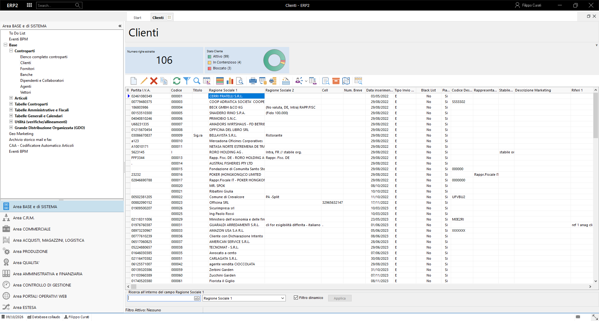

## 2. Leggere la griglia Clienti

In alto sono presenti **Numero righe estratte** e **Stato Cliente**: Attivo, In Contenzioso, Bloccato. Il totale riguarda l'estrazione, non soltanto le righe visibili.

Il layout osservato presenta:

| Colonne iniziali | Altre colonne disponibili nel layout osservato |
|---|---|
| Partita I.V.A., Codice, Titolo | Tipo Invio Doc., Black List, Piano dei conti |
| Ragione Sociale 1, Ragione Sociale 2 | Codice Destinatario, Rappresentante fiscale, Stabile organizzazione |
| Cell, Num. Breve, Data inserimento | Descrizione Marketing, Riferi 1/2/3, Note |

Ogni riga identifica un cliente tramite codice e ragione sociale, ad esempio **000001 — CERRI FRATELLI S.R.L.**.

La **riga corrente** e le **righe selezionate** possono essere usate da comandi differenti. Prima di operazioni multiple verificare il criterio **Tutte le righe / Solo righe selezionate** e l'eventuale conteggio mostrato.

Con il clic destro su una cella si apre il menu contestuale.

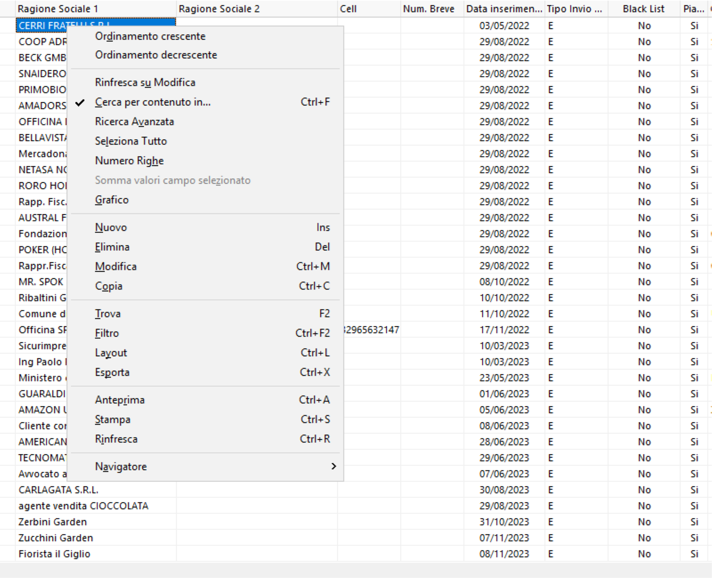

## 3. Creare un cliente

### Precompilazione

Premere **Nuovo** sulla toolbar o nel menu contestuale (**Ins**).

La finestra iniziale permette di ricercare dati tramite **Partita IVA** o **Codice Fiscale**. Compilare **Valore di ricerca** e premere **Ricerca dati**. Per l'inserimento manuale scegliere **Annulla precompilazione**.

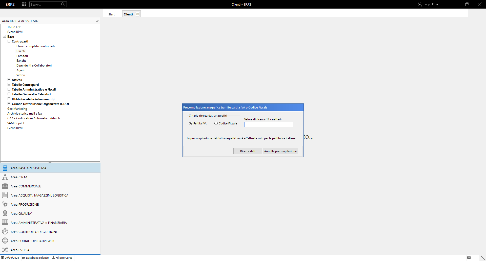

### Compilazione manuale

Nella scheda **Dati Generali** compilare la ragione sociale e i dati necessari. Il nuovo **Codice** viene assegnato da SAM al salvataggio.

- **Ragione Sociale 1 e 2**, indirizzo, frazione, CAP, comune, provincia, nazione e zona.
- Telefono, cellulare, fax, pagina WEB, e-mail e PEC.
- Numero breve, inserimento e distanza in km.
- Tipologia controparte, relazione societaria, profilo marketing e tipo invio documenti.
- Dati WEB, newsletter e giorni di chiusura.

La controparte può avere più ruoli: **Cliente, Fornitore, Banca, Vettore, Dipendente, Agente**. I ruoli possono determinare le schede disponibili.

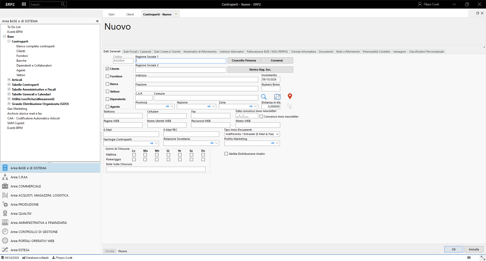

### Conferma

1. Compilare **Ragione Sociale 1** e i campi richiesti dalla configurazione aziendale, inclusi i classificatori obbligatori.
2. Premere **OK**.
3. Leggere le richieste di conferma e completare i dati indicati dalla form.
4. Tornare alla griglia, usare **Rinfresca** e verificare il cliente salvato.

Se non si intende completare l'inserimento usare **Annulla**.

## 4. Consultare e modificare

Selezionare il cliente e premere **Modifica**, disponibile anche nel popup con **Ctrl+M**. La form può aprirsi in **Lettura**, con OK disabilitato; la variazione dei campi può abilitare il salvataggio.

Controllare codice e ragione sociale nel titolo prima di intervenire. Confermare con **OK**, oppure usare **Annulla** per uscire. Prima di riaprire lo stesso cliente chiudere la sua scheda già aperta.

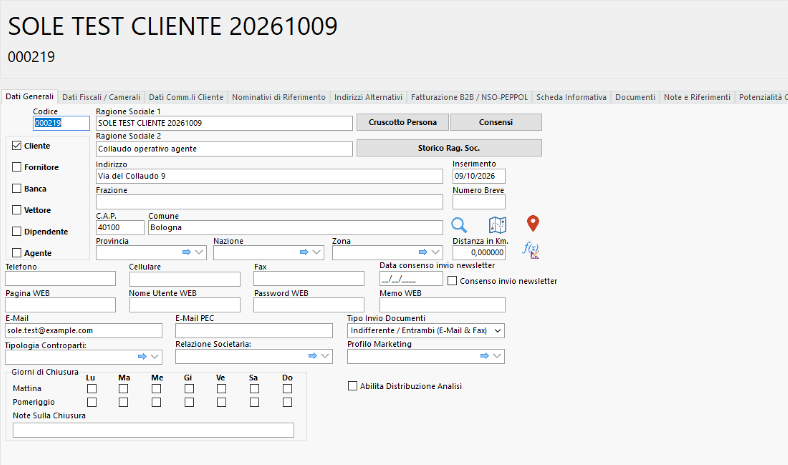

### Schede principali

| Scheda | Contenuto | Schermata |
|---|---|---|
| Dati Generali | Anagrafica, recapiti, ruoli, Cruscotto Persona, Consensi, Storico Rag. Soc. | [Apri](immagini/04-anagrafica-dati-generali.png) |
| Dati Fiscali / Camerali | Nascita, stato giuridico, sesso, partita IVA, codice fiscale, identificazione IVA, Ateco, forma giuridica, fatturato, capitale e dipendenti | [Apri](immagini/29-fiscali.png) |
| Dati Comm.li Cliente | Stato, dati commerciali, Trascodifica Articoli, Ins/Mod P.d.C., Elimina P.d.C. | [Apri](immagini/30-commerciali.png) |
| Nominativi di Riferimento | Nome, cognome, funzione, recapiti, tipologia, credenziali e newsletter | [Apri](immagini/31-nominativi.png) |
| Indirizzi Alternativi | Codice, tipo, stato, ragione sociale, indirizzo e recapiti; fatturazione e scheda informativa | [Apri](immagini/32-indirizzi.png) |
| Fatturazione B2B / NSO-PEPPOL | Codice destinatario, riferimenti amministrativi, causale, abilitazioni e identificativi | [Apri](immagini/33-fatturazione.png) |
| Scheda Informativa | Testo informativo | [Apri](immagini/34-scheda.png) |
| Documenti | Nome, tipo, modificato, dimensione, percorso; allegati | [Apri](immagini/35-documenti.png) |
| Note e Riferimenti | Riferi1/2/3, Descrizione Marketing, Note | [Apri](immagini/36-note.png) |
| Potenzialità Contatto | Prospect, tipologia, categoria, potenzialità, affidabilità, area, settore, agente e lingua | [Apri](immagini/37-potenzialita.png) |
| Immagine | Area immagine | [Apri](immagini/38-immagine.png) |
| Classificatori Personalizzati | Campi aziendali nelle sottoschede Controparti e Clienti | [Apri](immagini/39-classificatori.png) |

### Sottoschede commerciali

| Sottoscheda | Contenuto |
|---|---|
| Dati Generali | Lingua, riferimenti, destinazione fattura, tributo, agente/divisioni, SDD, ritenute e provvigioni |
| Condizioni Commerciali | Banca, conto corrente, CIN, IBAN, pagamento, valuta, sconti, fido e valutazione |
| Progressivi Co.Ge. | Fatturato e insoluti dell'anno corrente e precedente |
| Spese e Trasporto | Consegna, vettore, documento preferenziale, giorni spedizione, addebiti e logistica |
| Classificatori | Categoria, tipologia, area, potenzialità, affidabilità e settore |
| Listini di Vendita | Listini Associati / Non Associati e Articoli |
| CONAI | Non soggetto / soggetto / soggetto con plafond; dettaglio per riga |
| Credenziali | Nome utente, abilitazione, memo e password di accesso |
| Listini Assistenza | Listini, attività/articoli, prezzi e sconti |
| Controllo di Gestione | Centro di Ricavo/Profitto (B.U.) |
| GDO | Livello gerarchia commerciale |

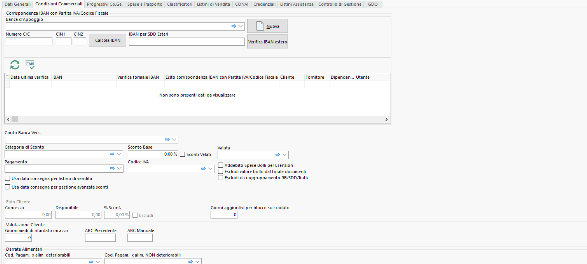

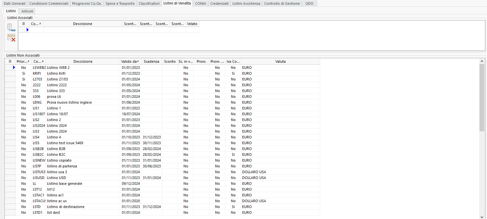

### Consensi e storico

**Consensi** apre la lista della controparte. Sono disponibili **Generici** e **Specifici per Cliente**; le colonne comprendono trattamento, consenso, data, nome, cognome e funzione.

**Visualizza Storico Consensi** passa alla consultazione dello storico; **Visualizza Consensi Attivi** ritorna agli attivi. **Chiudi** torna all'anagrafica.

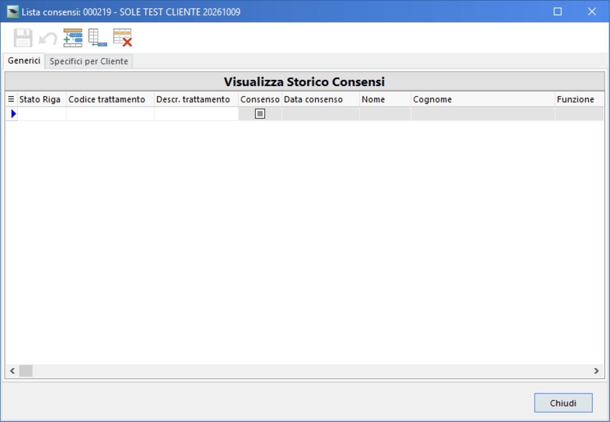

**Storico Rag. Soc.** apre Ragione Sociale 1, Ragione Sociale 2 e Data Fine Validità.

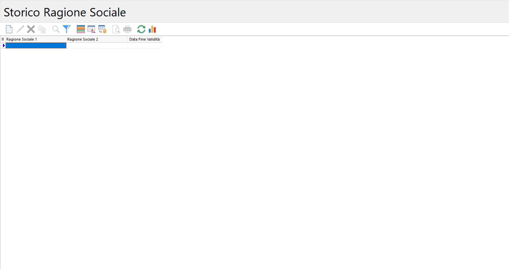

**Trascodifica Articoli** apre le codifiche articolo del cliente, con articolo, variante, descrizione cliente e garanzia in giorni/mesi/anni.

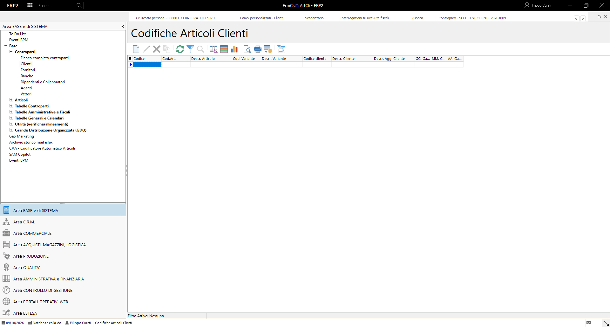

## 5. Ricerca, filtri e presentazione

### Ricerca

**Ricerca** o **Trova** nel popup (**F2**) permette di scegliere **Campo di Ricerca**, inserire **Valore da Ricercare**, impostare **Maiuscole/minuscole** e **Solo parole intere**, quindi confermare OK. Annulla chiude la ricerca.

Per individuare un cliente per nome, aprire **Campo di Ricerca**, scegliere **Ragione Sociale 1**, digitare il nome o una sua parte e premere **OK**. La griglia si posiziona sul cliente trovato; il comando non riduce necessariamente l’elenco a una sola riga.

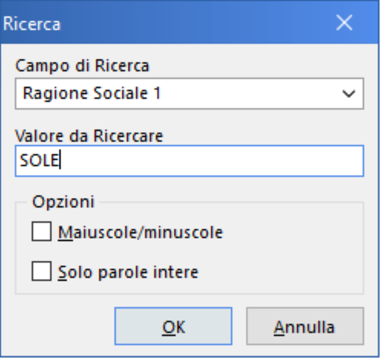

Sono disponibili anche **Cerca per contenuto in…** (**Ctrl+F**) e **Ricerca Avanzata**. Quando visibile, la ricerca inferiore offre selezione del campo, **Filtro dinamico** e **Applica**.

La **Ricerca Avanzata** permette di scegliere un classificatore e il relativo record. Usare **Applica** per confermare i criteri oppure **Annulla** per tornare all’elenco.

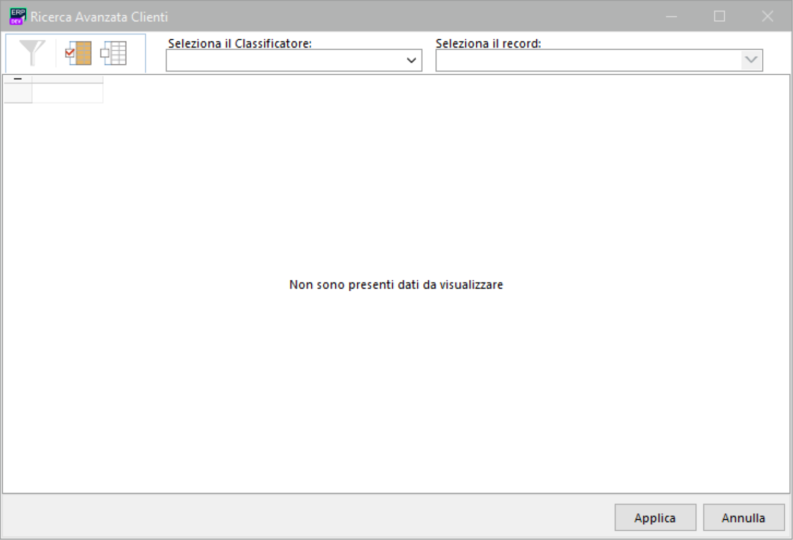

### Filtri

Aprire **Filtri** sulla toolbar o **Filtro** nel popup (**Ctrl+F2**):

1. Scegliere o immettere **Nome Filtro**.
2. Selezionare **Campo**, **Valore** e confronto.
3. Comporre le condizioni con **Aggiungi / Inserisci**; rimuoverle con **Elimina**.
4. Usare **E (And)** oppure **Oppure (Or)**.
5. Confermare OK.

Confronti disponibili: Uguale, Diverso, Maggiore, Minore, Maggiore Uguale, Minore Uguale, Contenuto In, Inizia Per. È presente anche l'eliminazione del filtro.

**Esempio: visualizzare soltanto un cliente.** Immettere un nome per il filtro, scegliere **Ragione Sociale 1**, mantenere il confronto **Uguale**, compilare la denominazione completa e confermare. La barra inferiore indica il filtro attivo. Per tornare all’elenco completo riaprire Filtri, scegliere **Nessuno** e confermare.

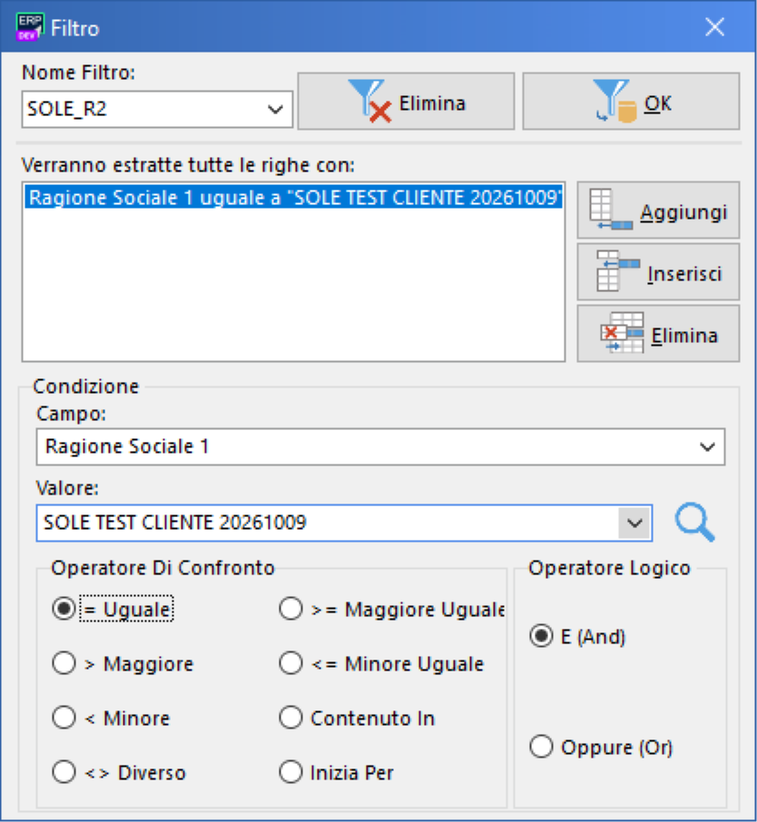

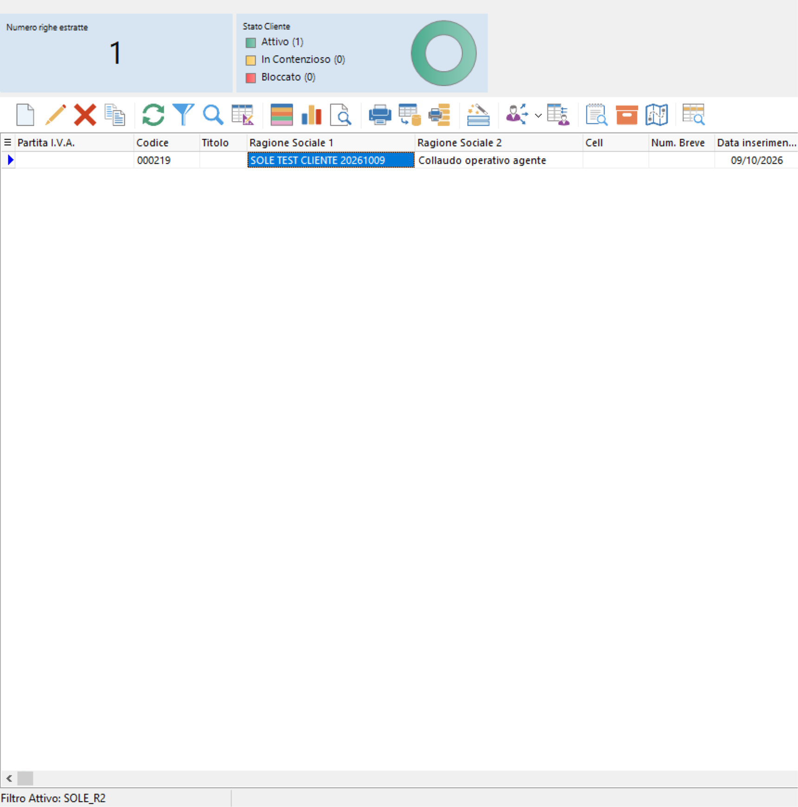

### Ordinamento e conteggio

Nel popup sono disponibili **Ordinamento crescente / decrescente**, **Seleziona Tutto**, **Numero Righe**, **Rinfresca su Modifica** e **Somma valori campo selezionato**.

**Rinfresca** aggiorna la gestione; è accessibile anche con **Ctrl+R**.

### Layout

**Configura / Layout** (**Ctrl+L**) apre **Campi Disponibili** e **Campi Visualizzati**, ciascuno con ricerca. Sono presenti comandi centrali di trasferimento e icone di rimozione. Confermare con OK o uscire con Annulla.

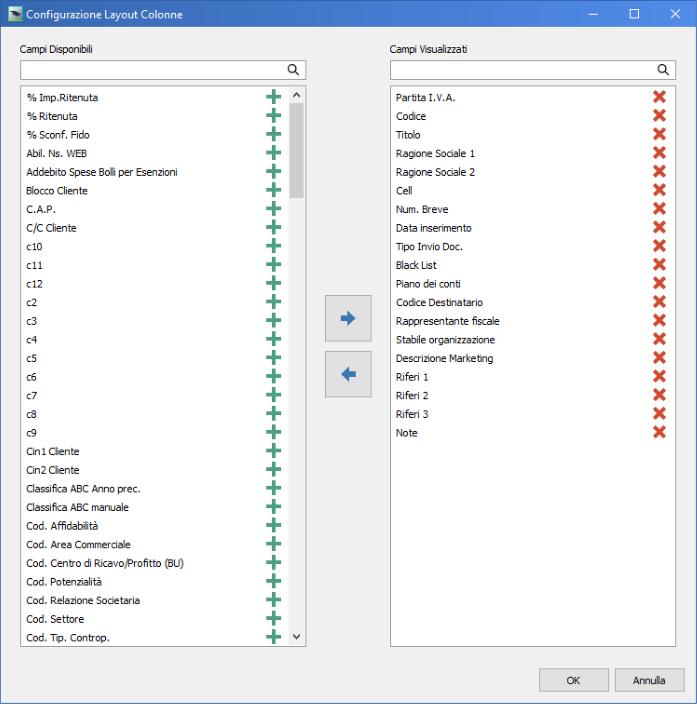

### Colori e grafici

**Colori** permette di definire nome, priorità, condizioni, colore dell'inchiostro e dello sfondo, Corsivo, Grassetto, Sottolineato e Barrato; l'area **Esempio** mostra la presentazione.

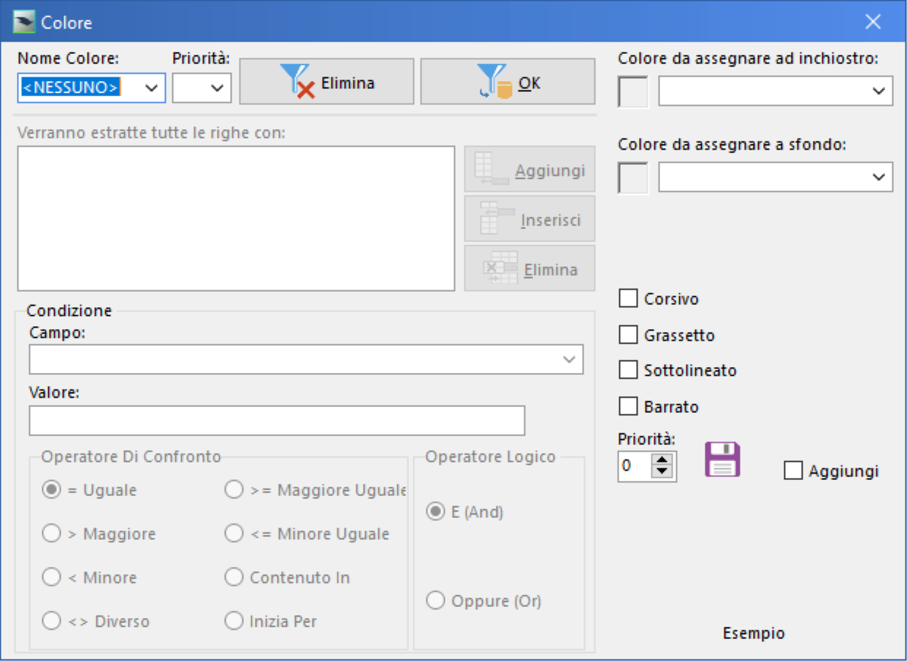

**Grafico** apre selezione Etichette e Dati, **Includi conteggio dati**, **Raggruppa dati**, tipologia, **Crea Grafico** e Annulla. Selezionare l'etichetta prima di creare il grafico.

Per un riepilogo del numero di clienti, scegliere **Ragione Sociale 1** come etichetta e attivare **Includi conteggio dati**, quindi **Crea Grafico**.

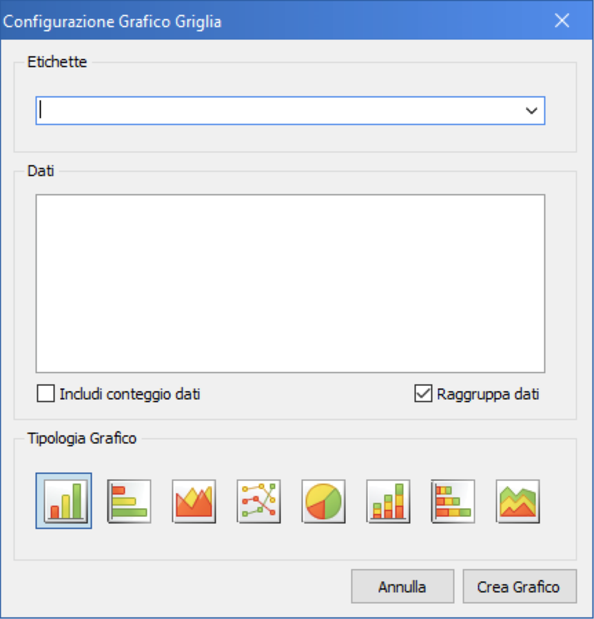

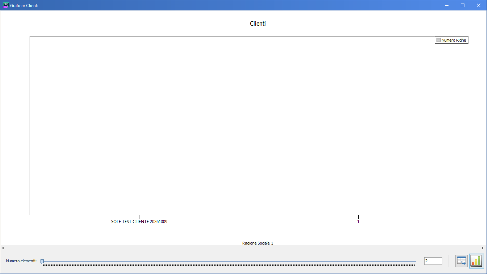

## 6. Copiare ed eliminare

### Copia

1. Selezionare la controparte sorgente e verificare la ragione sociale.
2. Premere **Copia** (**Ctrl+C** nel popup).
3. Aprire **Nuovo** e procedere oltre la precompilazione.
4. Premere **Incolla** nell'anagrafica.
5. Controllare dati e ruoli copiati, correggere quelli del nuovo cliente e salvare solo dopo verifica.

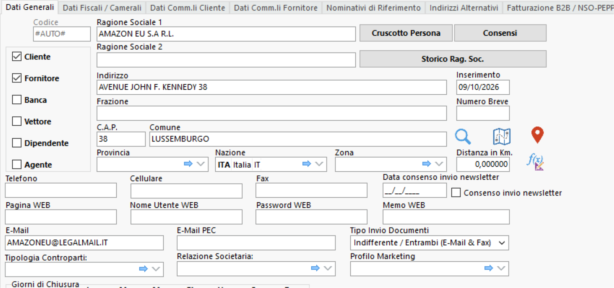

### Eliminazione

Selezionare il cliente e premere **Elimina** (**Del** nel popup). Alla richiesta **Eliminare il record selezionato?**, **No** annulla la cancellazione; **Yes** conferma la richiesta.

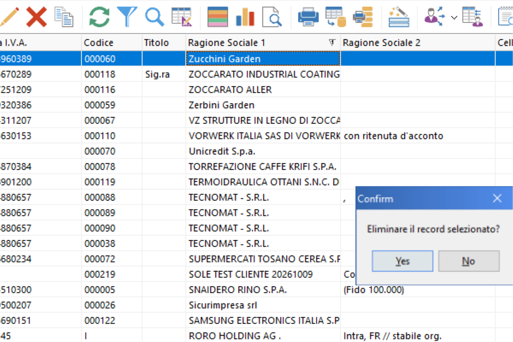

## 7. Stampare ed esportare

### Report e anteprima

**ERP2 - Selezione report** offre Gruppo, Categoria, Lingua, visualizzazione **Tutti / Standard / Personalizzati**, elenco dei modelli di presentazione, OK e Annulla. Scegliere il modello desiderato e confermare.

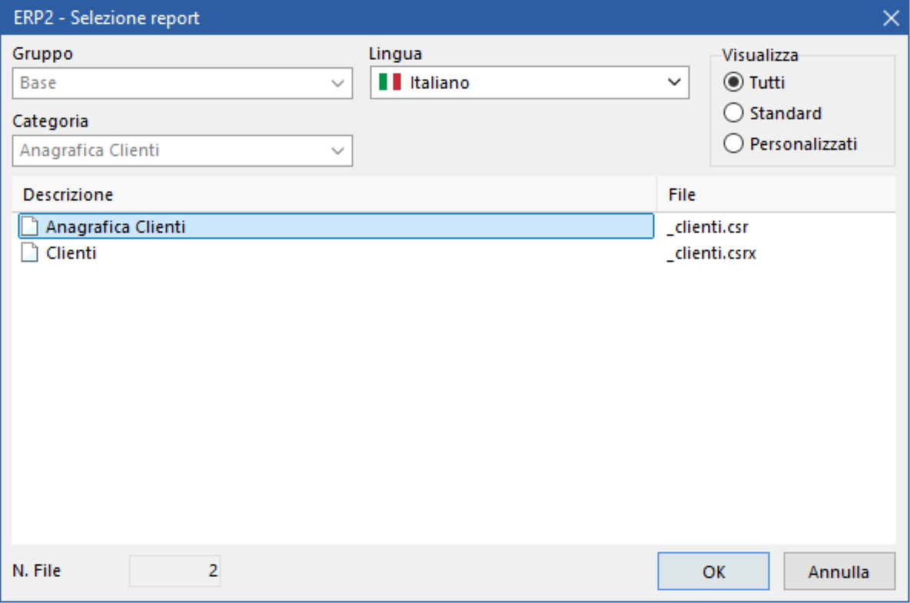

Per **Anteprima di stampa** (**Ctrl+A** nel popup), scegliere il criterio delle righe se richiesto, selezionare il report e attendere la generazione. L'anteprima mostra il numero pagina e la presentazione **Pagina intera**.

Applicando prima un filtro si può ottenere un’anteprima limitata ai clienti di interesse.

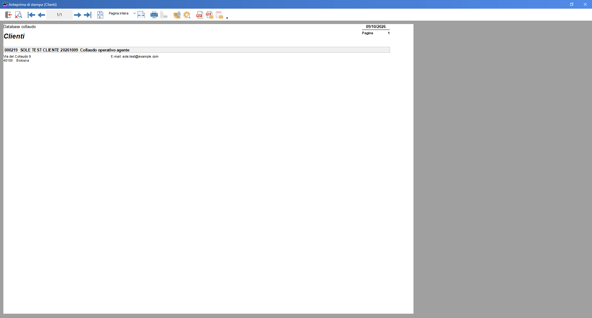

### Stampa PDF

**Stampa** (**Ctrl+S** nel popup) → selezione report → finestra Stampa → scegliere **Microsoft Print to PDF** → OK → indicare il nome del file → Salva.

La finestra Stampa offre anche proprietà stampante, intervallo pagine, copie e fascicolazione.

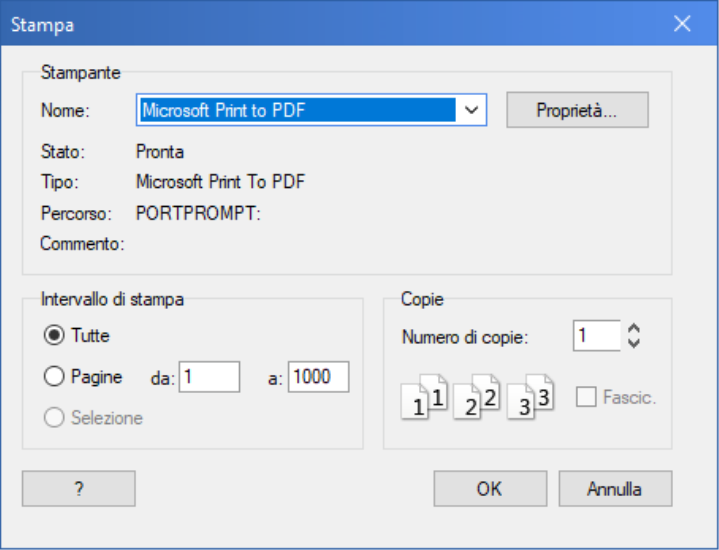

### Etichette

**Stampa Etichette** richiede numero etichette per controparte, colonne e numero etichette da saltare. Verificare la selezione: senza clienti selezionati SAM propone di procedere per tutti i clienti. Per la disposizione a tre colonne scegliere il modello **Etichette controparti 3 colonne**.

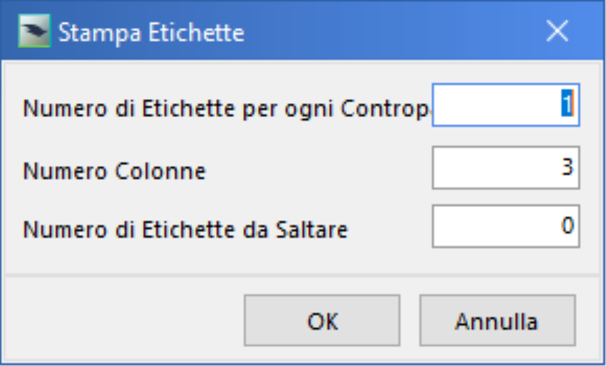

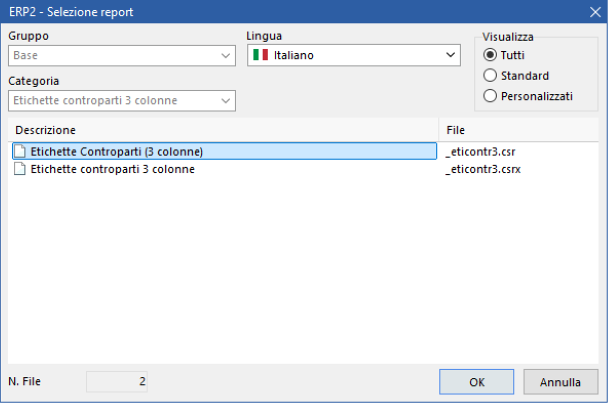

### Esportazione

**Esporta in formato… / Esporta** (**Ctrl+X** nel popup): scegliere il formato, OK, compilare **Salva con nome**, Salva.

Scegliere nell’elenco la presentazione desiderata, ad esempio un foglio Excel, un documento Word o un testo. Le opzioni indicano anche quando è richiesta la presenza di Excel o Word sul computer.

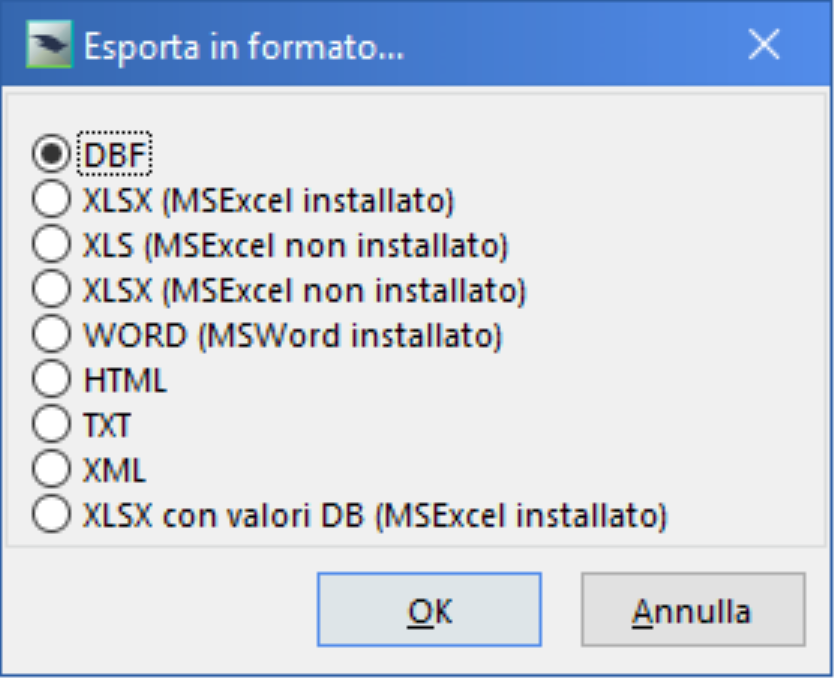

## 8. Funzioni collegate

### Azioni multiple e campagne

Il menu di **Azioni Multiple** offre **Azione, Mail, Appuntamento, Allegato, Work Flow, NewsLetters**. Scegliere la voce e verificare il criterio **Tutte le righe / Solo righe selezionate** prima di proseguire.

### Compilazione dell’azione

Dopo la scelta dei clienti si apre **Azione - Nuovo**. Verificare il **Contatto**, scegliere il **Tipo**, compilare una **Descrizione** chiara, impostare **Inizio** e **Fine**, quindi scegliere incaricato, responsabile e stato secondo l’attività da svolgere. Le schede **Informazioni**, **Delega** e **Riferimenti**, oltre a note e allegati, raccolgono i dettagli dell’attività. Confermare con **OK** oppure uscire con **Annulla**.

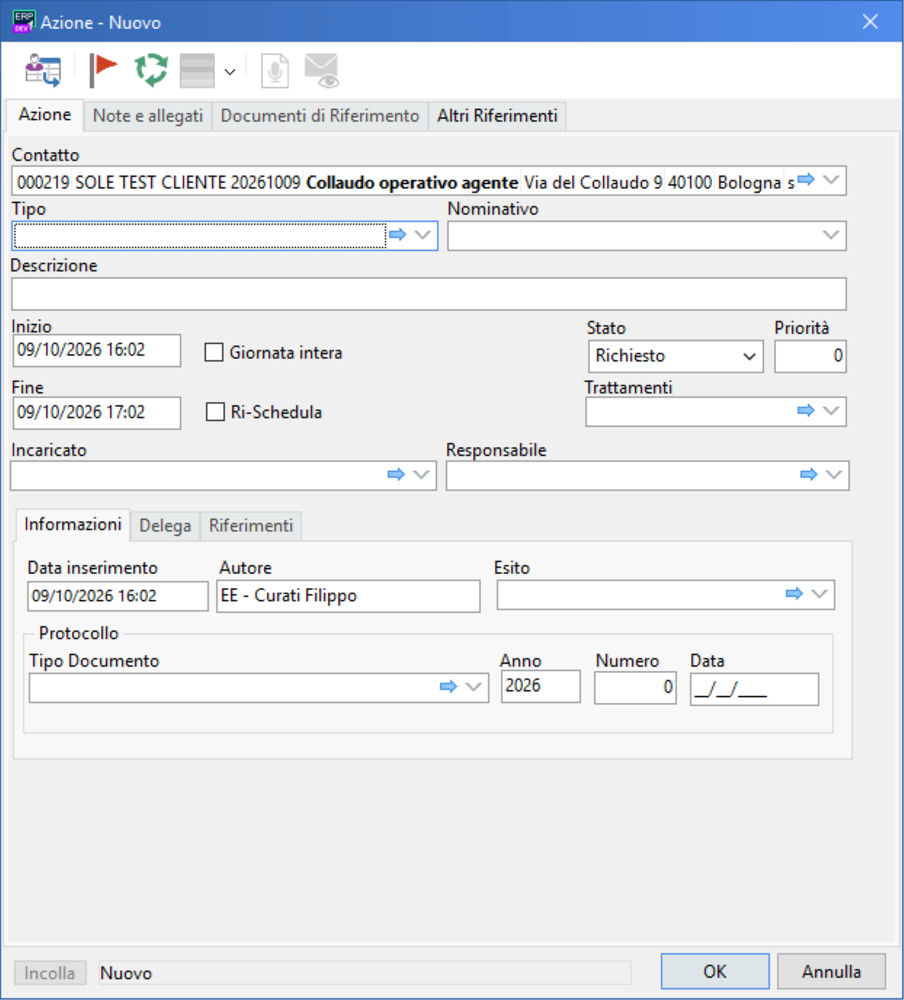

### Preparazione campagna

**Prepara Campagna** richiede il criterio delle righe. Nella finestra **Preparazione campagna** verificare il **Contatto**, scegliere la **Campagna** e utilizzare **OK** per confermare o **Annulla** per tornare alla griglia.

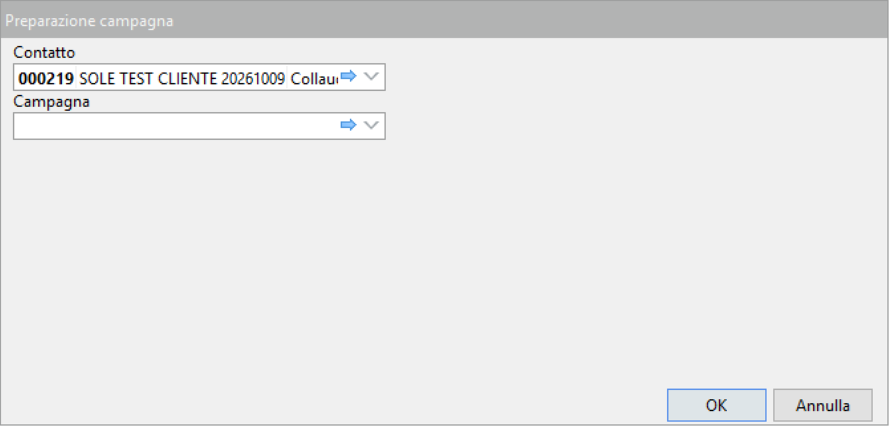

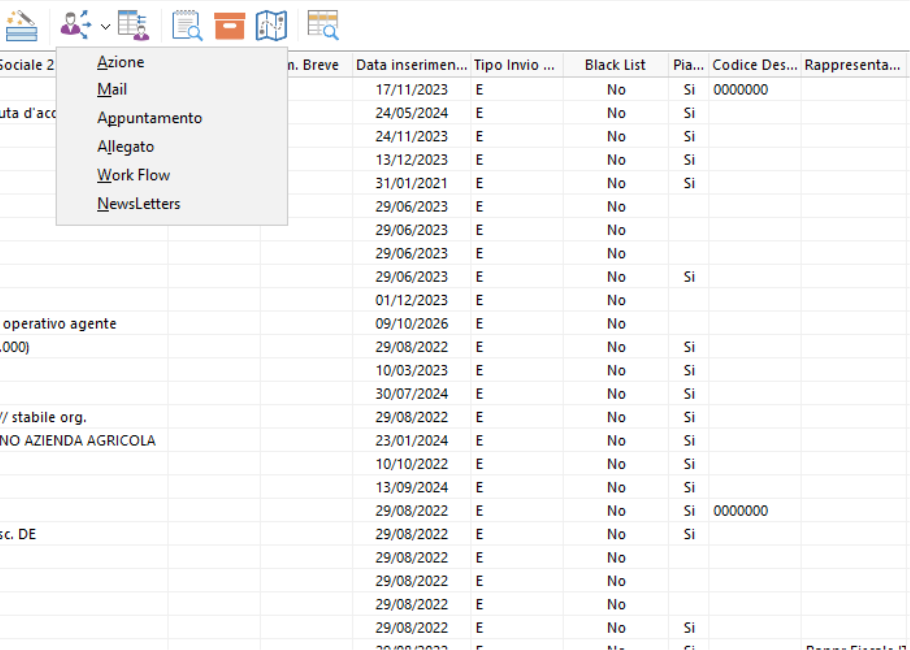

### Cruscotto

**Visualizza cruscotto**, disponibile anche come **Cruscotto Persona** nell'anagrafica, raccoglie Azioni, Mail, CRM e Documenti. Sono presenti sezioni su campagne, offerte, commesse, DDT, fatture, contabilità, prodotti installati, servizi, interventi, attività e documenti fornitori. Sono disponibili **Ricerca avanzata**, **Estrai tutto / Estrai selezione**.

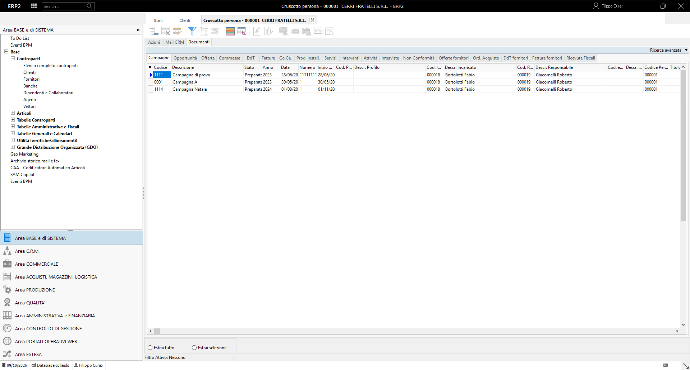

### Altri accessi

- **Visualizzazione dossier**: accesso al browser per la gestione dossier.
- **Geo Marketing**: scegliere le righe da utilizzare per aprire la mappa dei clienti. La barra inferiore riporta gli elementi trovati e quelli selezionati; il nome del cliente è visibile nella mappa.
- **Visualizza dettaglio IBAN — Ctrl+D**: richiede una controparte selezionata.
- **Tool Personalizzazione Classificatori**: apre i campi personalizzati Clienti, con tabella, campo, titolo, tipo, decimali e altre proprietà.

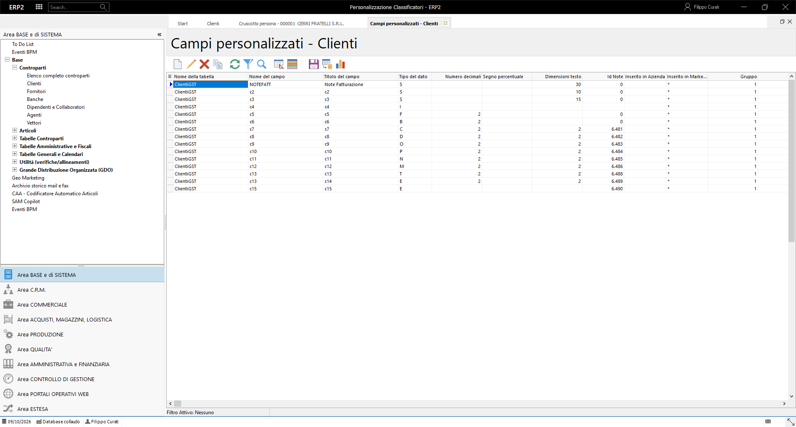

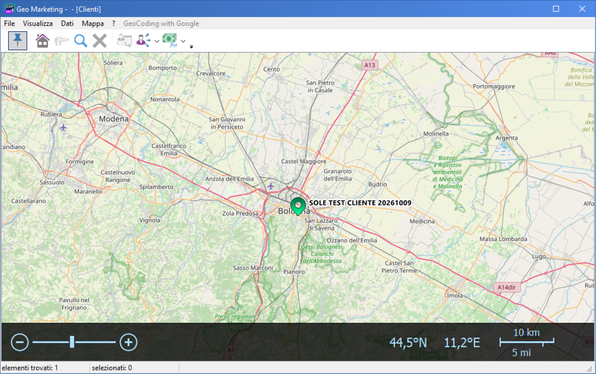

### Navigatore

Dal popup **Navigatore** si accede a:

1. Clienti;
2. Schede Contabili;
3. Estratto conto per partita;
4. Scadenzario;
5. Scheda Credito, Scoperto e Rischio Cliente;
6. Interrogazioni O.V. e Offerte;
7. Interrogazioni su ricevute fiscali;
8. Interrogazioni su Spedizioni;
9. Interrogazioni su Fatture;
10. Rubrica.

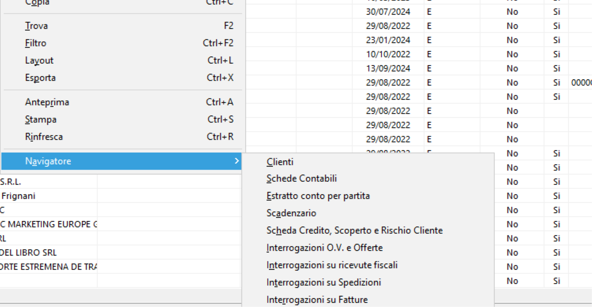

**Schede Contabili**, **Estratto conto per partita** e **Scheda Credito, Scoperto e Rischio Cliente** aprono una finestra di selezione. Verificare conti e periodi prima di confermare con OK. Annulla torna alla gestione senza applicare nuove selezioni.

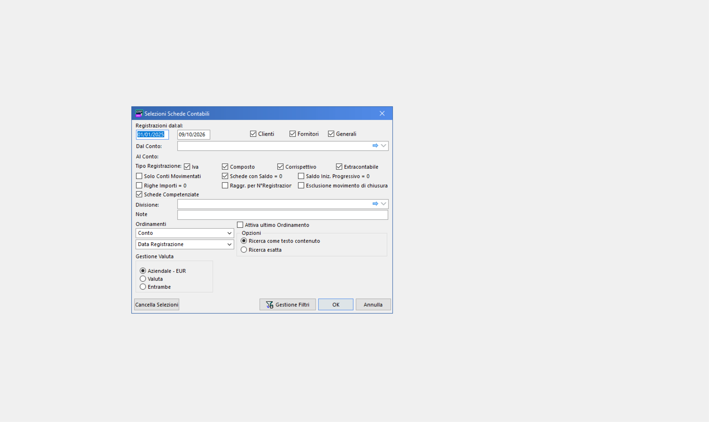

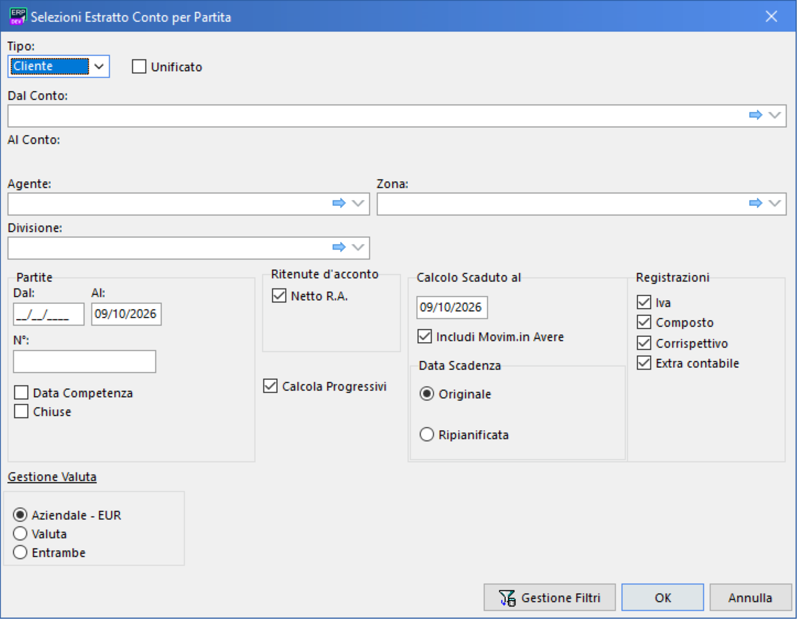

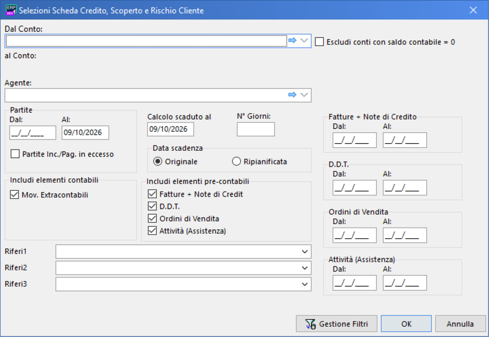

Lo **Scadenzario** mostra dati della partita, causale, importi, pagamento e scadenza. Nell'esempio letto su Zucchini Garden: un record, **1.608,20 Dare**, scadenza **31/12/2023**.

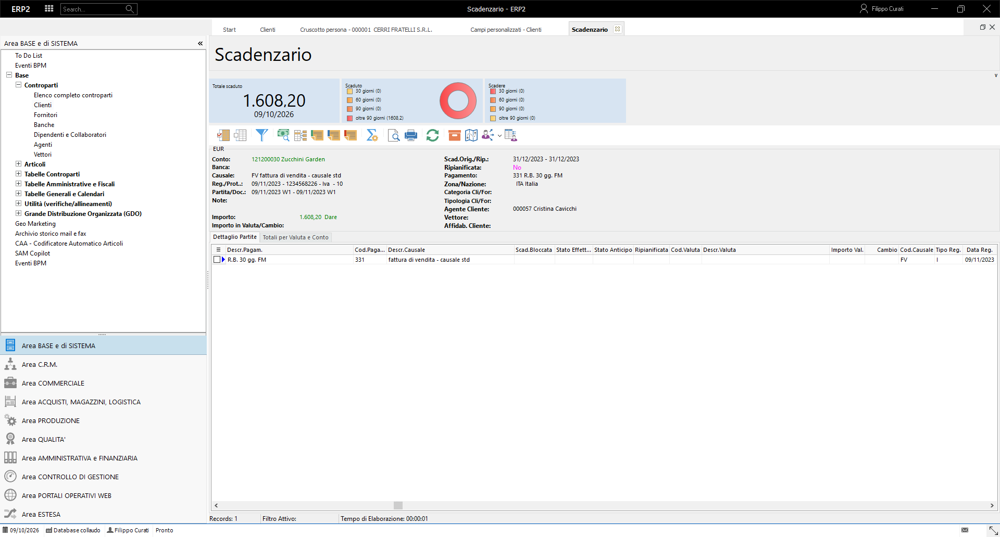

Le **Interrogazioni su ricevute fiscali** presentano Documenti/Riepilogo Righe, Note Documento e Totali, Righe Documento e totali per omaggi, sconti e spese.

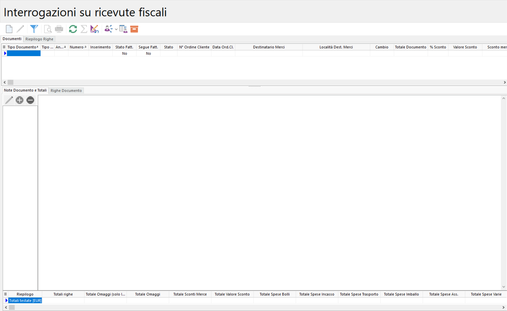

La **Rubrica** raccoglie tipo, azienda, telefono, cellulare, fax, e-mail, indirizzo e dati della controparte.

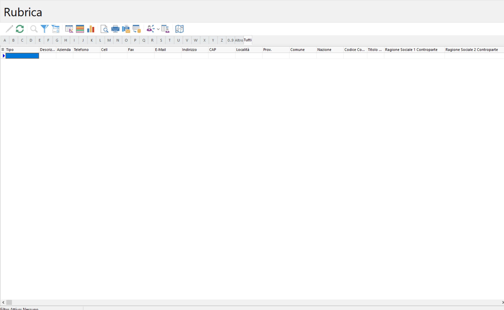

## 9. Accessi equivalenti e scorciatoie

| Funzione | Accessi |
|---|---|
| Nuovo | Toolbar, popup, Ins |
| Modifica | Toolbar, popup, Ctrl+M |
| Elimina | Toolbar, popup, Del |
| Copia | Toolbar, popup, Ctrl+C; Incolla nella form |
| Trova | Ricerca sulla toolbar, popup, F2 |
| Filtro | Filtri sulla toolbar, popup, Ctrl+F2 |
| Layout | Configura sulla toolbar, popup, Ctrl+L |
| Esporta | Toolbar, popup, Ctrl+X |
| Anteprima | Toolbar, popup, Ctrl+A |
| Stampa | Toolbar, popup, Ctrl+S |
| Rinfresca | Toolbar, popup, Ctrl+R |
| Cruscotto | Toolbar Clienti, Cruscotto Persona nell'anagrafica |

Le scorciatoie fanno riferimento alla gestione attiva: controllare il focus prima di utilizzarle. I menu possono offrire punti di accesso diversi alla stessa funzione.
