# Gestione Opportunità — Manuale operativo SAM ERP

La Scheda Opportunità raccoglie le trattative commerciali: il contatto interessato, i prodotti o servizi proposti, i valori economici e le informazioni per seguirne l’avanzamento.

## 1. Aprire l’elenco delle opportunità

Nel menu a sinistra scegliere **Area C.R.M. → CRM-I Marketing → Opportunità → Scheda Opportunità**.

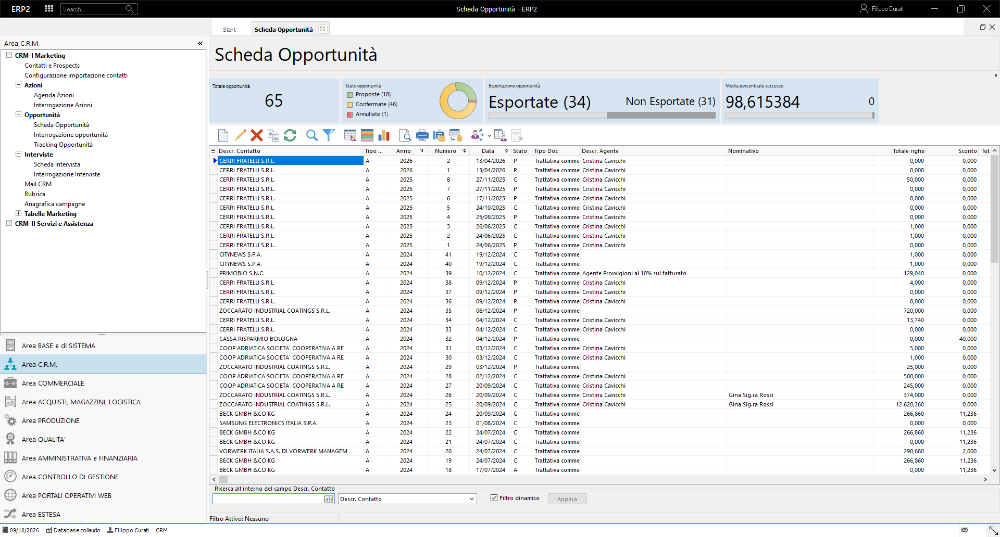

In alto sono disponibili i riepiloghi del totale, dello stato e dell’esportazione delle opportunità. Gli stati sono **Proposta**, **Confermata** e **Annullata**.

L’elenco mostra contatto, tipo documento, anno, numero, data, stato, agente e nominativo. Le colonne economiche comprendono **Totale righe**, **Sconto**, **Totale documento**, **% Successo**, **Tot. righe pesato** e **Tot. doc. pesato**. La colonna **Esportata** indica se l’opportunità è stata trasferita verso un documento di vendita.

Usare le barre di scorrimento per leggere le colonne fuori dalla parte visibile. **Rinfresca** aggiorna l’elenco e i riepiloghi.

## 2. Individuare le opportunità di interesse

### Ricerca

1. Premere **Ricerca**, oppure **Trova** nel menu del clic destro.
2. Scegliere il **Campo di Ricerca**.
3. Inserire il valore da cercare.
4. Se necessario impostare **Maiuscole/minuscole** o **Solo parole intere**.
5. Premere **OK**.

Per cercare una trattativa per cliente scegliere **Descr. Contatto** e digitare il nome o una sua parte. La ricerca posiziona l’elenco sul risultato.

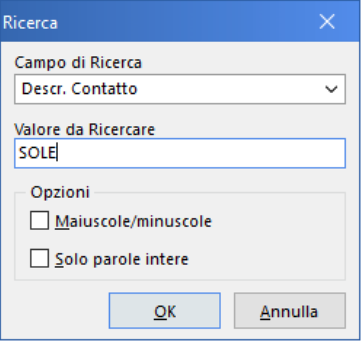

### Filtri

Un filtro permette di limitare l’elenco alle opportunità che soddisfano le condizioni desiderate.

1. Aprire **Filtri**.
2. Scegliere o scrivere il nome del filtro.
3. Selezionare il campo, il confronto e il valore.
4. Usare **Aggiungi** o **Inserisci** per comporre più condizioni.
5. Collegare le condizioni con **E (And)** oppure **Oppure (Or)**.
6. Confermare con **OK**.

Per mostrare le opportunità di un solo contatto usare **Descr. Contatto**, confronto **Uguale**, e la denominazione completa. La barra inferiore indica il filtro attivo. Per tornare all’elenco generale selezionare **Nessuno** nella finestra Filtri e confermare.

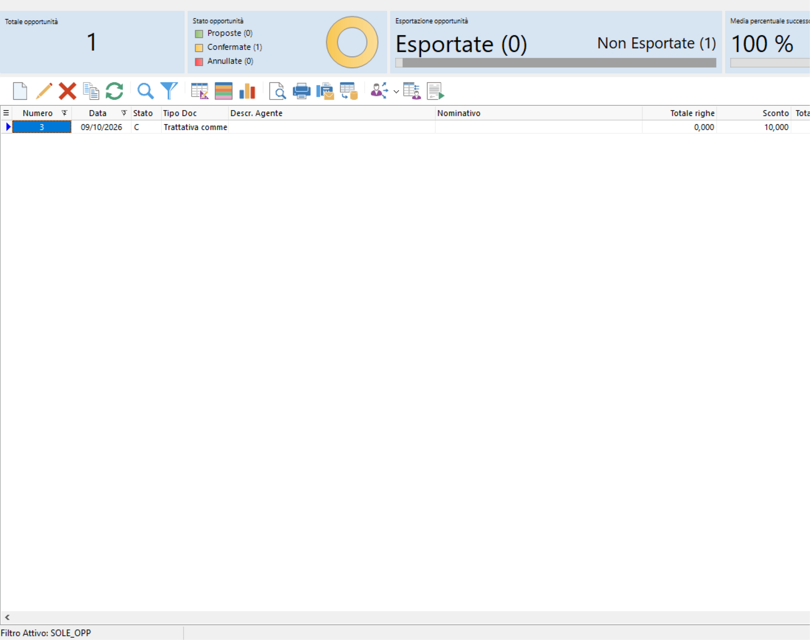

### Ordinamento, selezione e conteggio

Con il clic destro su una colonna sono disponibili **Ordinamento crescente**, **Ordinamento decrescente**, **Seleziona Tutto**, **Numero Righe** e **Somma valori campo selezionato**. Per una somma economica scegliere prima la colonna economica desiderata.

La riga corrente e le righe selezionate hanno scopi diversi: prima di un’operazione su più opportunità verificare la selezione e il criterio richiesto dal programma.

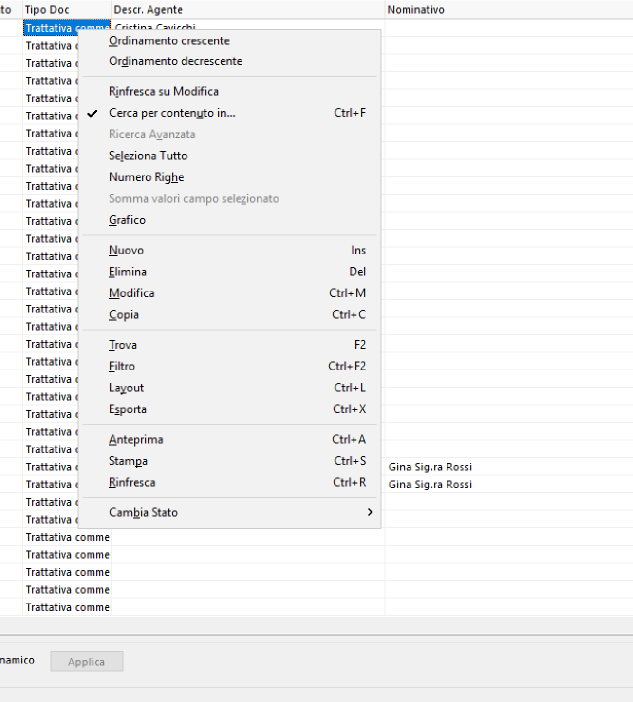

## 3. Inserire un’opportunità

Premere **Nuovo**. La scheda presenta **Tipo Documento**, **Anno**, **Numero**, **Data** e **Stato**, quindi le sezioni **Testata**, **Righe**, **Scheda commerciale** e **Tracking**.

### Compilare la Testata

1. Verificare il tipo documento e la data.
2. Selezionare il **Contatto** intestatario della trattativa. Se si conosce il codice, digitarlo nel campo e passare al successivo: SAM richiama il contatto e i suoi recapiti.
3. Scegliere, quando necessario, **Indirizzo Alternativo** e **Nominativo di Riferimento**.
4. Verificare la **Valuta** e il **Cambio**.
5. Compilare agente, nominativo addetto, responsabile e le informazioni di firma pertinenti.
6. Inserire le **Note** utili alla trattativa.

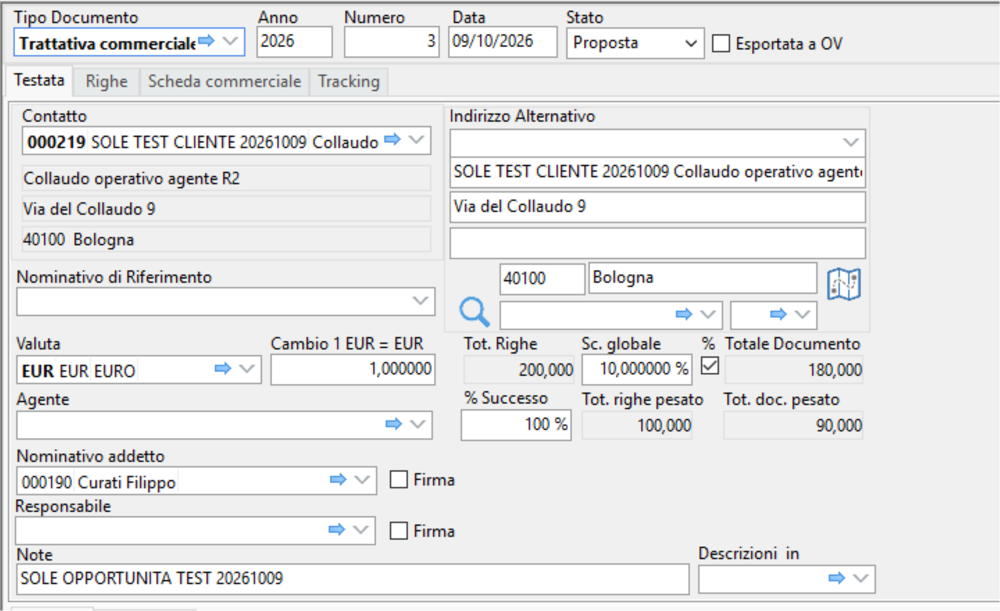

Il contatto è necessario per completare l’inserimento. I recapiti richiamati aiutano a verificare di aver scelto l’intestatario corretto.

### Inserire le righe

Aprire **Righe** e usare **Aggiunge una nuova riga** sulla barra dei comandi.

1. Scegliere l’**Articolo** oppure compilare la **Descrizione** della proposta.
2. Inserire eventuale **Descrizione Aggiuntiva** e unità di misura.
3. Compilare **Q.tà**, prezzo unitario lordo e sconto della riga.
4. Impostare **% Successo** della riga.
5. Completare i classificatori pertinenti: classe, gruppo, marca, linea di prodotto e categoria omogenea.
6. Aggiungere eventuali note.
7. Premere **Memorizza i dati della riga**.

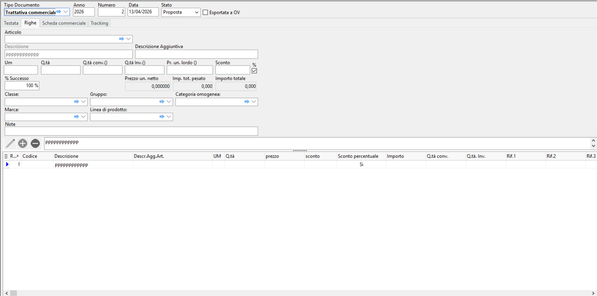

Se SAM richiede di memorizzare una riga prima di proseguire, confermare per conservarla. Le richieste relative ai classificatori guidano la compilazione dei dati della proposta.

### Leggere i totali

La testata mostra **Tot. Righe**, **Sc. globale %**, **Totale Documento**, **Tot. righe pesato** e **Tot. doc. pesato**.

Esempio: quantità **2**, prezzo unitario **100**, successo riga **50%** producono un valore di riga **200** e un valore pesato **100**. Con sconto globale **10%**, il totale documento diventa **180** e il totale pesato documento **90**.

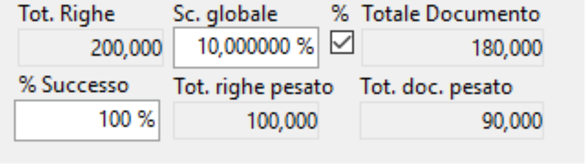

Controllare sempre questi valori prima di confermare la trattativa.

### Salvare

Premere **OK** oppure **Salva il documento**. Tornare all’elenco e usare **Rinfresca**; riaprire l’opportunità per controllare dati e righe salvati.

Per uscire senza conservare variazioni usare **Annulla** e leggere la richiesta relativa ai dati non ancora memorizzati.

## 4. Modificare e organizzare le righe

Selezionare l’opportunità e premere **Modifica**. Controllare anno, numero e contatto prima di cambiare i dati.

La barra della scheda offre:

| Comando | Utilizzo |
|---|---|
| Aggiunge una nuova riga | Inserire una voce aggiuntiva |
| Inserisce una riga alla posizione corrente | Aggiungere una voce nel punto scelto |
| Duplica riga corrente | Riprendere una riga come base per un’altra proposta |
| Sposta in basso / in alto | Organizzare la sequenza delle voci |
| Memorizza i dati della riga | Confermare la compilazione della riga |
| Annulla le modifiche alla riga | Abbandonare la modifica corrente |
| Elimina la riga dal documento | Rimuovere la voce selezionata |
| Espande/Riduce la griglia articoli | Adattare lo spazio dedicato all’elenco |
| Annotazioni su righe | Aprire note e allegati della voce |

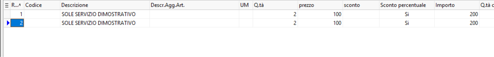

Le **Annotazioni su righe** aprono una finestra con **Note** e **Allegati**. Confermare con OK o chiudere con Annulla.

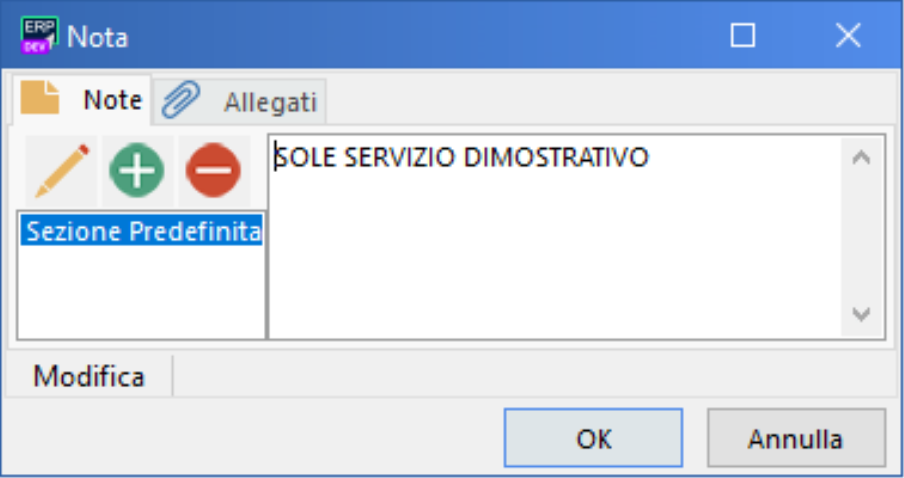

## 5. Informazioni commerciali e Tracking

### Scheda commerciale

Raccoglie validità e relativo riferimento, note di validità, riferimento conferma cliente, prima richiesta, revisione e riferimento commerciale. Sono presenti anche **Valutazione**, **Avanzamento**, **Esito** e **Campagna**.

Usare i campi data per le date richieste e i selettori per le classificazioni disponibili. Queste informazioni aiutano a ricostruire il percorso della trattativa.

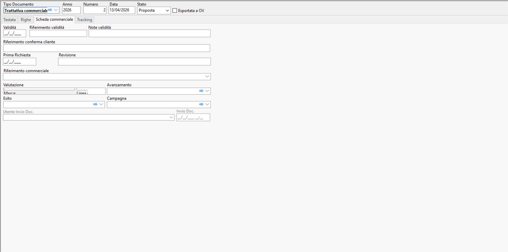

### Tracking

La sezione Tracking raccoglie il numero e i totali delle offerte e delle commesse collegate, l’imponibile, l’IVA e i riepiloghi del secondo livello.

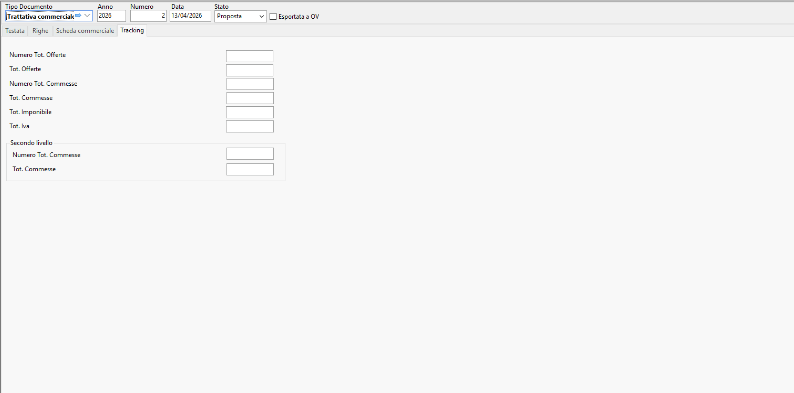

## 6. Cambiare lo stato

Per aggiornare una singola opportunità:

1. Aprire **Modifica**.
2. Aprire l’elenco **Stato**.
3. Scegliere **Proposta**, **Confermata** oppure **Annullata**.
4. Salvare e rinfrescare l’elenco.

I riepiloghi mostrano il numero di opportunità per ciascuno stato.

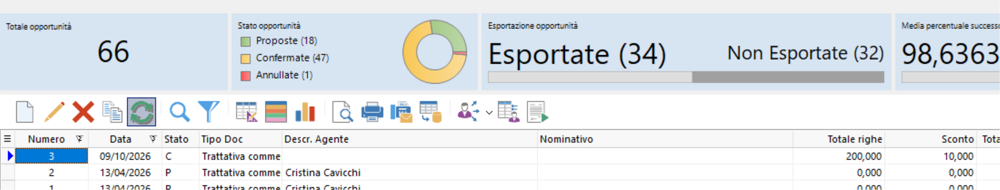

Il menu del clic destro offre anche **Cambia Stato → Proposto / Confermato / Annullato** per le righe selezionate. Verificare la selezione prima di usare questo comando.

## 7. Copiare ed eliminare opportunità

### Copia

1. Selezionare l’opportunità sorgente e premere **Copia**.
2. Aprire **Nuovo**.
3. Premere **Incolla**.
4. Scegliere cosa riprendere nella finestra di scelta, ad esempio **Testata e Righe**.
5. Controllare intestatario, data, stato, righe e importi prima di completare il nuovo documento.

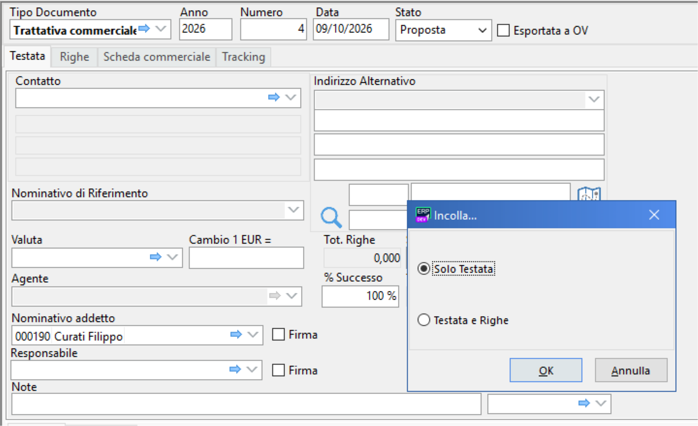

### Eliminazione

Selezionare l’opportunità corretta e premere **Elimina**. Leggere la richiesta di conferma: **Yes** procede con l’eliminazione, **No** la annulla. Rinfrescare l’elenco per verificare il risultato.

## 8. Esportare verso un documento di vendita

**Esporta Opportunità** apre **Configurazione esportazione opportunità** per le righe selezionate.

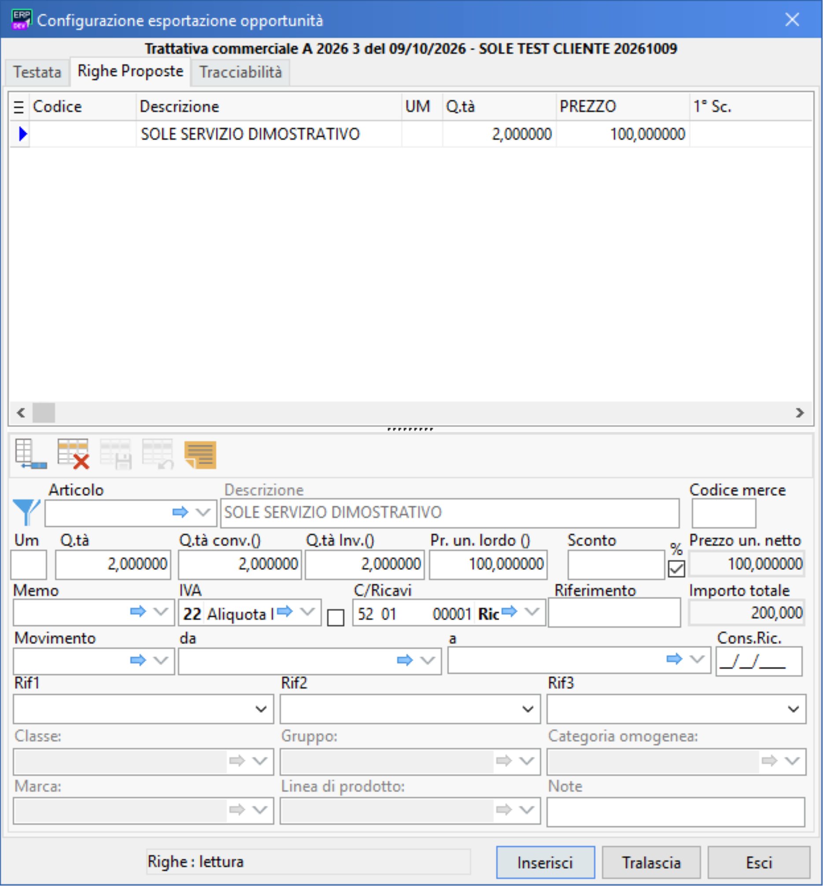

La finestra offre **Testata**, **Righe**, **Proposte** e **Tracciabilità**.

Nella **Testata** verificare il documento di destinazione, cliente, data, causale, responsabili, valuta e sconto. Il comando **Evolvi contatto trattativa a cliente** è disponibile quando la trasformazione del contatto è pertinente.

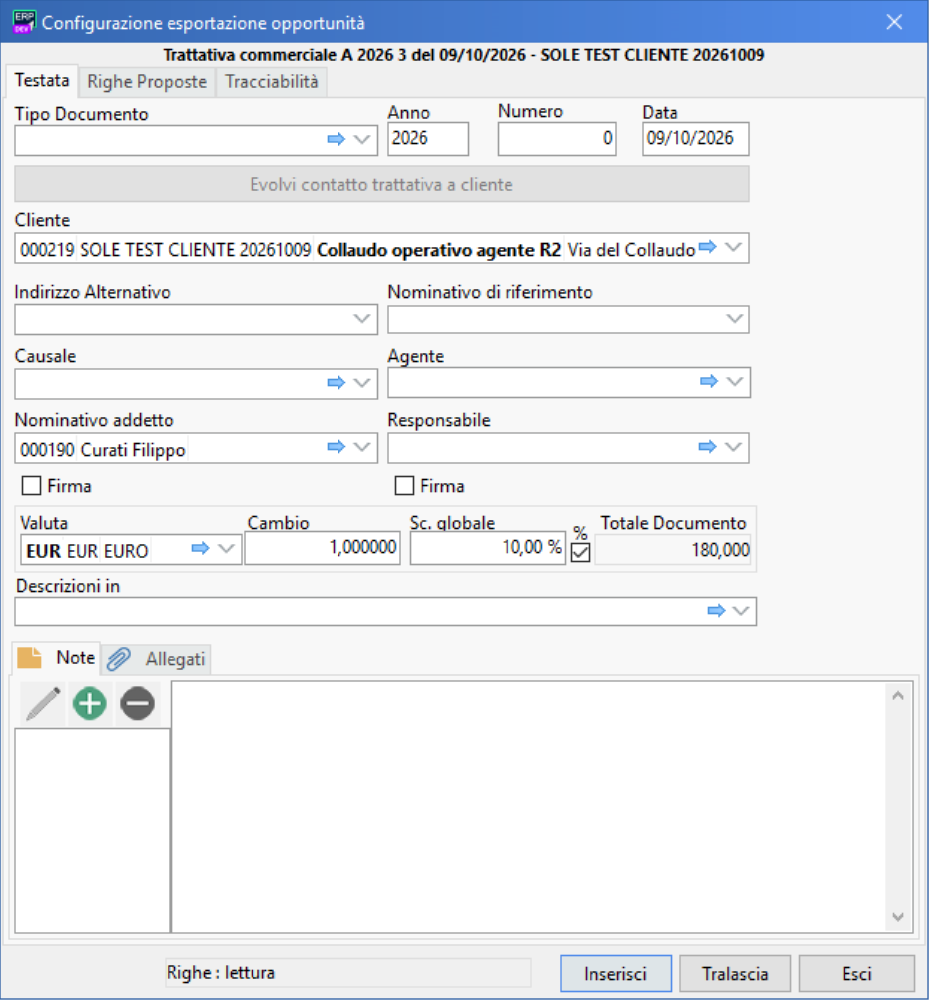

Nelle **Righe** verificare descrizione, quantità, prezzo, IVA, conto ricavi e informazioni di consegna. Sono disponibili **Inserisci**, **Tralascia** ed **Esci**. Completare i campi richiesti prima di procedere.

## 9. Personalizzare l’elenco e rappresentare i dati

**Configura** apre **Campi Disponibili** e **Campi Visualizzati**. Le ricerche aiutano a trovare le colonne. Confermare con OK oppure uscire con Annulla.

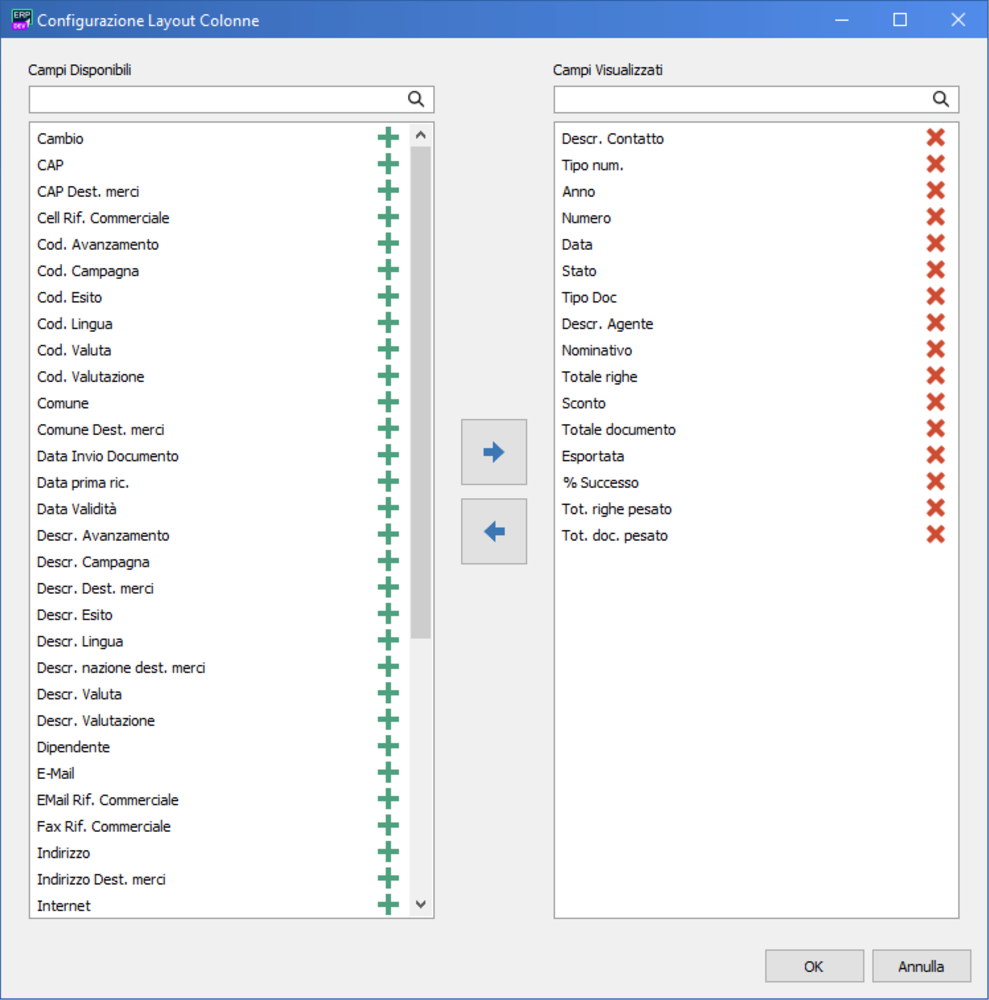

**Colori** permette di definire condizioni e presentazione del testo e dello sfondo, con un esempio dello stile scelto.

Il **Grafico** del menu contestuale permette di scegliere un’etichetta e i dati da rappresentare. Per visualizzare un conteggio per contatto scegliere **Descr. Contatto**, attivare **Includi conteggio dati** e premere **Crea Grafico**.

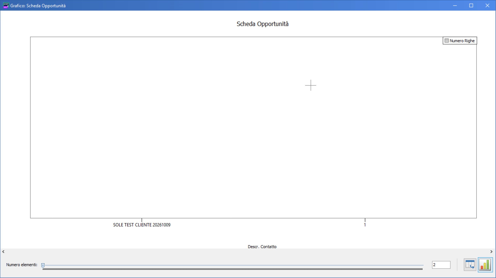

## 10. Anteprima, stampa e invio

**Anteprima di stampa**, **Stampa** e **Invio e-Mail/Fax** permettono di scegliere il criterio dei documenti e il modello di presentazione.

Quando si sceglie **Tutte le righe**, leggere la conferma relativa ai documenti da produrre. L’anteprima può presentare più documenti in sequenza.

Nell’anteprima sono disponibili navigazione tra fogli, pagina intera, larghezza, stampa, salvataggio PDF e invio via e-mail. Per interrompere l’intera sequenza usare **Interrompi i processi in corso e esci** e confermare; **Chiudi** può passare al documento successivo.

**Esporta in formato…** permette di salvare l’elenco nella presentazione scelta. Scegliere l’opzione desiderata, indicare il nome e la destinazione del file e confermare Salva.

## 11. Scorciatoie e accessi alternativi

| Funzione | Scorciatoia nel menu contestuale |
|---|---|
| Nuovo | Ins |
| Elimina | Del |
| Modifica | Ctrl+M |
| Copia | Ctrl+C |
| Trova | F2 |
| Filtro | Ctrl+F2 |
| Layout | Ctrl+L |
| Esporta | Ctrl+X |
| Anteprima | Ctrl+A |
| Stampa | Ctrl+S |
| Rinfresca | Ctrl+R |

Le scorciatoie agiscono sulla finestra corrente: verificare dove si sta lavorando prima di utilizzarle.
